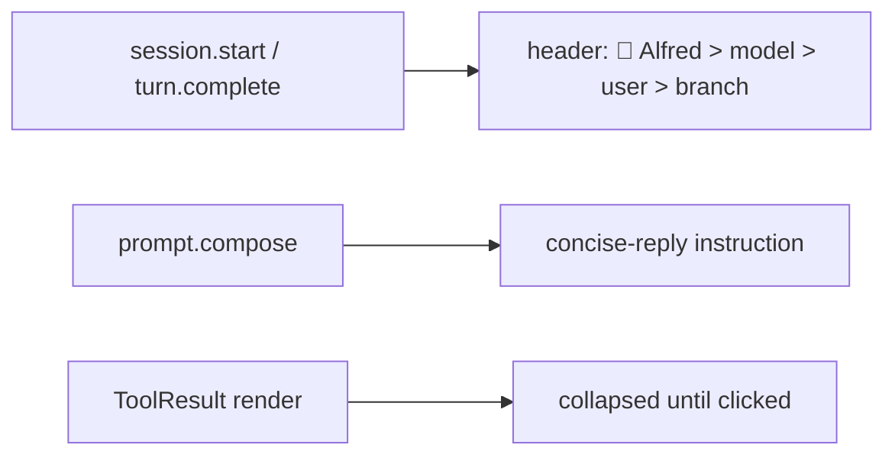

# batman-remode

## Why

Claude Code's default UI is noisy. This mod strips it down.

## Architecture



## Plan

- [x] Minimal header above the prompt
- [x] Concise replies
- [x] Tool logs hidden until clicked
- [ ] Add author to manifest

## Setup

```
/plugin install batman-remode --marketplace manoj-malviya-96/claude-world
```

Answer `y` to add the marketplace, then pick the user scope.
